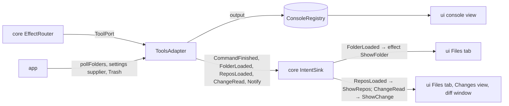

# `tools`

The development tools behind `core`'s `ToolPort`: Gradle runs with their console and test tree, the Files tab's
folders read as trees and their entries moved to the Trash, and the git repositories of those folders read. Everything runs outside the reducer and the EDT and ends
in an intent. It depends on `core` only.

1. [Architecture](#1-architecture)
2. [Interface with the rest of the app](#2-interface-with-the-rest-of-the-app)
3. [Threads](#3-threads)
4. [Tests](#4-tests)

## 1. Architecture

| Class | Does |
|---|---|
| `ToolsAdapter` | the port: Gradle runs as child processes, folder reads, the folder poll, moves to the Trash, the repositories' reads |
| `Git` | the `git` command line, read only: the repositories a folder belongs to, `git status --porcelain=v2` parsed into a `RepoStatus` and the ignored entries, a changed file's `HEAD` and working-tree versions; each run bounded (10 s, 32 MB), without optional locks or prompts, killed at close |
| `GradleBuild` | the build a directory belongs to (the nearest directory at or above it with an executable `gradlew`) and the command: `<gradle-serial> <root> <tasks>`, else `<root>/gradlew --console=plain <tasks>` |
| `Args` | splits the tasks the user typed as a POSIX shell splits words, without expansion |
| `TestReports` | JUnit XML written since the run started, as a tree with failures first, each linked to its source line |
| `FolderTree` | a folder as a tree, ordered and bounded (12 levels; 80 000 names listed, 20 000 entries kept), without the entries a caller skips |
| `ListingLines` | the lines a listing file (such as a scratchpad day's `INDEX.md`) gives an entry, taken out once the entry went to the Trash |
| `ToolSettings` | where the tools are, by convention: the kit's `gradle-serial` when it is executable, and the JDK for child processes |

- **A Gradle run.** The process runs on a virtual thread that copies its output into the run's `Console` (past 4 MB
  the rest is held and its last 64 kB shown at the end) and sends `CommandFinished` with the exit code, the test tree
  and the failures. A stop sends SIGTERM to the process tree, SIGKILL 2 s later; output is read at most 2 s after the
  process exits.
- **Settings per run.** `ToolsAdapter` takes a `Supplier<ToolSettings>` and asks it at each run, so a kit installed
  while comando runs is used from the next run.
- **Folders.** `readFolders` reads once and sends each tree; `watchFolders` replaces the set the poll reads, and the
  poll sends a tree only when it changed. Reads are ticketed, so an older read never overwrites a newer one.
- **Repositories.** `watchRepos` names every configured folder. The poll reads, before the folders, the repositories
  of the watched folders (of all while the Changes view is open) every poll, the others every sixth, and sends
  `ReposLoaded`, every repository, when any changed. A folder
  in a repository is read without what git ignores, from a status at most 30 s old; a folder git ignores as a whole is
  read whole. `readChange` reads a change's two versions on one thread, in the order asked, and sends `ChangeRead`.
- **The Trash.** `deleteFiles` moves entries through a `ToolsAdapter.Trash`, then edits the folder's listing file and
  reads the open folders again. Nothing is deleted for good.

## 2. Interface with the rest of the app

**Provides.**

| Interface | Methods | Caller |
|---|---|---|
| `ToolPort` | `runGradle(runId, workDir, tasks)`, `cancelRun`, `forgetRun`, `readFolders`, `watchFolders`, `deleteFiles(folder, paths)`, `watchRepos(folders, changesShown)`, `readChange(root, change, follow)` | the reducer's effects, through `EffectRouter` |
| `ToolsAdapter.pollFolders(every)` | starts the folder poll | `app` at start (every 5 s) |
| `ToolsAdapter.Trash` | `moveToTrash(file)`; `Trash.NONE` for tests and desktops without one | implemented in `ui` (`DesktopTrash`), passed in by `app`, so `tools` never imports Swing or AWT |

**Needs.** The `IntentSink`, the `ConsoleRegistry` it writes, a `Supplier<ToolSettings>` (`app` builds it from
`claude`'s `Kit.gradleSerial()`), and a `Trash`.

**Sends back.** `CommandFinished` (the reducer updates the run's console view and may ask for a desktop
notification), `FolderLoaded` (the reducer turns it into a `ShowFolder` effect for the Files tab), `ReposLoaded`
(`ShowRepos`: the Files tab's colours and the Changes view), `ChangeRead` (`ShowChange`: the diff window), `Notify`.

The terminal is not here: JediTerm is a Swing component and lives in `ui`.

## 3. Threads

| Thread | Does |
|---|---|
| `gradle-<run>`, `tool-output-<run>`, `tool-kill-<run>` | virtual: the run's process, its output, the SIGKILL after a stop |
| `folder-read` | virtual: a read asked for now |
| `folder-poll` | platform, daemon: reads the watched folders every period |
| `file-trash` | virtual: moves to the Trash and the listing edits |
| `repo-read` | virtual: the repositories read at once when `watchRepos` changes them |
| `change-read` | virtual, one at a time: a changed file's two versions |
| `repo-write` | virtual, one at a time: `RollBack`, `RemoveFiles`, `Unstage` through git (`restore`, `rm --cached`) and the Trash, then the repositories read again |
| `git-out`, `git-err` | virtual, per git run: its output and the start of its errors |

`close()` stops every run's process tree (SIGTERM, SIGKILL 2 s later), the folder poll, the change reads and every git
run.

## 4. Tests

`ToolsAdapterTest` runs a fake `gradlew` (a shell script that prints its arguments and writes one failing JUnit report)
and folder reads in temporary directories; `GitTest` and `ToolsAdapterReposTest` build a repository with the real
`git` in a temporary directory (a change of each kind, an ignored folder); `ListingLinesTest` and `ToolSettingsTest`
are unit tests.

Further reading: [Workbench §4.2](../docs/workbench.md#42-gradle-runs), [Workbench §5](../docs/workbench.md#5-the-files-tab),
[record 62](../docs/adr/0062-gradle-runs-by-convention.md), [record 68](../docs/adr/0068-git-changes-and-a-side-by-side-diff.md).
