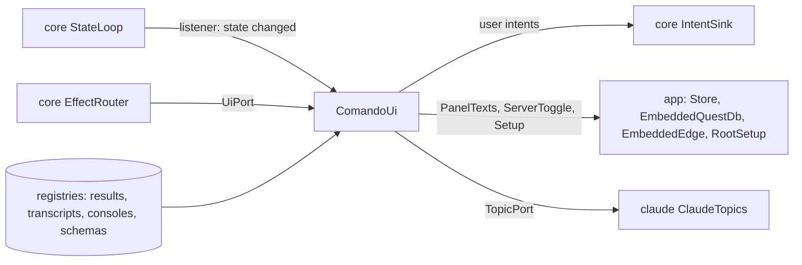

# `ui`

The Swing window: the shell, the editor panels, the lower panel and side pane, the sidebar, the dialogs, the widgets and
the kit they share. It renders `core`'s `AppState`, turns input into intents, and does the effects addressed to the
window. It depends on `core` and the UI libraries (FlatLaf and its extras, jsvg, RSyntaxTextArea and AutoComplete,
CommonMark with its tables extension, java-diff-utils, JediTerm, pty4j, Jackson; slf4j-jdk14 at run time), never on
`db`, `claude`, `mcp` or `tools`. `app` alone constructs it.

1. [Architecture](#1-architecture)
2. [Interface with the rest of the app](#2-interface-with-the-rest-of-the-app)
3. [Threads](#3-threads)
4. [Tests](#4-tests)

## 1. Architecture

The packages under `dev.marregui.comando.ui`, in layer order: a layer uses only the layers above it in this table.

| Package | Holds |
|---|---|
| `kit.theme` | the palette: `Theme`, `NamedTheme` (the six themes), `Ground`, `Tint`, `OnGround`, `ContentPalette` (content colours derived from tint and ground), `Oklch`, `SidebarLook`, `TintBarBorder`, `TintTitle`, `GroundIcon` |
| `kit.icon` | `Icons` (the SVGs), `SpinnerIcon`, `OverlayIcon`, `BesideIcon`, `RowIcon` |
| `kit.action` | `Command`, `ActionRegistry`, `CommandPalette`, `MenuEntry`, `KeyPriority` (the commands' keys before the focused component's), `ToolButton` |
| `kit.async` | `Edt`, `Coalescer`, `Debouncer`, `EdtWatchdog`, `ShownTimer` (a timer that ticks only while its owner shows), `UiErrands` |
| `kit.overlay` | `Overlay`, `Balloon`, `Flash` |
| `kit.format` | `Json`, `KeyText` (a key as the desktop writes it), `Labels` |
| `kit.text` | editors and their themes (`Editors`, `EditorThemes`, `Highlighter`), Markdown and HTML (`MarkdownHtml`, `RenderedMarkdown`, `HtmlPane`, `FrontMatter`, `Fences`, `MermaidDiagrams`, `LocalImages`), plain text (`Plain`, `LogLines`, `TextSearch`), links (`TextLinks`, `LocalLinks`, `NoteLinks`, `SourceLinks`), diffs (`Diffs`, `DiffPane`, `SplitDiff`) |
| `kit.tree`, `kit.tabs`, `kit.layout` | `TreeView`; `MovableTabs`, `TabStrip`; `ShrinkingRow` |
| `kit.resource` | `ResourceActions`: a resource row's menu |
| `kit.desktop` | `Browser`, `ExternalEditor`, `FileChoosers`, `FileSearch`, `Links` (a double-clicked link followed), `DesktopTrash`, `Platform` (the desktop's keys) |
| `kit.vcs` | `RepoChanges` (the Files tab's git marks), `OpenedFiles` |
| `widget` | the contract: `Widget`, `WidgetContext`, `WidgetRegistry`, `Unmountable` (listeners and timers released in one call); `capability`: `Searchable`, `Copyable`, `Exportable`, `Zoomable`, `FindBar`, `Capabilities` |
| `widgets.*` | one package per widget: `approval` (`ApprovalInbox`), `changes` (`ChangesWidget`, `ChangeEditor`), `console` (`ConsoleWidget`), `diff` (`DiffWidget`), `editor` (`CommandEditor`, `PanelDocument`, `PanelTokenMaker`, `SqlCompletion`), `markdown` (`MarkdownWidget`), `plot` (`PlotWidget`, `PlotCanvas`), `table` (`TableViewWidget`, `GridTable`, `TableSource`), `terminal` (`TerminalWidget`, `Pty`, `InputGate`), `text` (`TextWidget`), `tree` (`TreeWidget`) |
| `widgets.transcript` | `TranscriptWidget`, `TranscriptView`, `AgentWidget` (a sub-agent's tab), `AgentStrip`, `ToolText`; `doc`: `MarkdownDoc`, `Para`, `Span`; `render`: `TranscriptCanvas` (the painted transcript), `Items` and its `Item`s (`ToolCallItem` among them), `Paras`, `Rich`, `TextBox`, `Placed`, `Style`, `Marks`, `Fold`, `Finder` (find within cells), `AgentTracker` |
| `panels` | the window's regions: `Workspace`, `EditorPanel` (with `OutlinePane`), `LowerPanel`, `SidePane`, `StatusBar`, `SessionBar`, `ResultsView` (with `PlanTree`), `TerminalTabs`, `ViewTabs`, `SessionsSidebar` (its rows: `IconRow`, `SessionRow`, `ConnectionRow`; `PanelsWithoutSession`), `FilesTab`, `TabCard`, `CardFacts`, `Delegation`, `TabStatus`, `SessionIcons`, `CommandButton`, `ThemeButton` |
| `dialogs` | `folders` (`FoldersEditor`, `FoldersDialog`), `jobs` (`JobsEditor`, `JobsDialog`), `resource` (`ResourceDialog`, one dialog for connections and sessions), `sessions` (`ImportSessionsDialog`, `StoredConversation`) |
| `shell` | `ComandoUi` (the frame and the UI port) and the parts it delegates to: `Commands` (the command table), `MenuBuilder` and `Menus`, `Keys`, `LayoutKeeper` (splits and panes), `FocusRouter` and `FocusOrigins` (where the keyboard goes back to), `PanelFiles` (files opened, panels saved, views exported), `QuitFlow` and `ClosingCover`, `ShellParts`; then `WindowLayout`, `Settings`, `HelpActions`, `HelpFiles`, `About`, `MarkdownSheet`, `AppIcon`, `KitActions`, `JobActions`, `LivePlots`, `ResultViews`, `Attachments`, `Notifier`, `OpenFiles`, `DiffWindow`, `WorkedIn`; `ServerToggle` and `Setup`, implemented in `app` |
| (top) | `PanelTexts`: editor text between saves, implemented in `app` |

`UiArchitectureTest` (ArchUnit) fails the build when a widget imports another widget or anything but the kit, the
contract and `core`; when `kit` imports a layer below it, or the contract a widget, `panels`, `dialogs` or `shell`;
when `panels` imports `dialogs` or `shell`, or `dialogs` imports `shell`; and on any reference to `db`, `claude`,
`mcp`, `tools` or `java.sql`.

**Render.** `ComandoUi` registers a `StateLoop.Listener`. Each state change requests a render through a `Coalescer`, so
many changes become at most one pending `invokeLater`, which reads the latest state. Growing stores (transcripts,
consoles) ask for repaints the same way.

**Input.** Every user action is a `Command` in the `ActionRegistry` (menus, keys, palette), registered once by
`Commands`; a command dispatches an intent. Blocking work (opening a file, links, exports, the kit's git and `kit.py`
runs) moves to an errand of `UiErrands`.

**Views.** `WidgetRegistry` maps a placed view's type (`table`, `plot`, `diff`, `markdown`, `text`, `tree`, `console`,
`agent`, `changes`) to a widget. `ViewTabs` creates it when the view appears, renders it when its version changes, and
unmounts it when it closes.

**Text from outside** (Claude, a database, a file) reaches Swing as text, never as HTML (`Plain`, `MarkdownHtml`).

A new view type is a `ViewSpec` record in `core`, a package under `widgets`, a registration in `ComandoUi`, and for
Claude a case in `mcp`'s `ViewSpecs`.

## 2. Interface with the rest of the app

**Provides.**

| Interface | Methods | Caller |
|---|---|---|
| `UiPort` | `editPanel`, `notifyDesktop`, `forgetPanel`, `deletePanel`, `showFile`, `arrange`, `showFolder`, `showRepos`, `showChange`, `showPlanUsage`; each hands its work to the EDT, an errand (`showFile`) or the store (`forgetPanel`, `deletePanel`) and returns | the reducer's effects, through `EffectRouter` |
| `ComandoUi(Dependencies)`, `topics(port)`, `start()`, `kitStatus(status)`, `close()` | builds and shows the window from any thread; reads the tabs' topics through the port `topics` sets before `start()`; shows the kit's version on the Files tab's KIT row; closes terminals, live plots, the EDT watchdog and the window, then the errands | `app` |
| `MermaidDiagrams.install(cache)`, `LocalImages.install(cache)` and their `shutdown()` | the drawing services Markdown previews use, with their caches under the data root | `app` |
| `DesktopTrash.moveToTrash(file)` | the desktop's Trash | `app` passes it to `tools` as its `Trash` |

**Needs.** `ComandoUi.Dependencies`, filled by `app`:

| Field | Is |
|---|---|
| `intents`, `state`, `loop` | the `IntentSink`, the state snapshot, the `StateLoop` to listen to |
| `transcripts`, `results`, `consoles`, `schemas` | `core`'s registries, read here |
| `texts` | `PanelTexts`: each panel's file and text (`app`'s `Store`) |
| `catalogue` | the stored conversations for the import dialog, as `StoredConversation` (`app` maps `claude`'s `SessionCatalogue`) |
| `server` | `ServerToggle`: the embedded QuestDB (`app`'s `EmbeddedQuestDb`) |
| `edge` | `ServerToggle`: the comando Edge (`app`'s `EmbeddedEdge`), its button right of QuestDB's; null, no button |
| `setup` | `Setup`: the kit root comando runs on, the kit's version and newer releases, the brain's and the kit's backups, the kit's jobs (`app`'s `RootSetup`). `KitActions` shows the kit on the KIT row, sends the upgrade to the session `kit` and offers to restart the sessions on the old kit once it reported; `JobActions` reads the kit's jobs at start, after each change and every minute while the Files tab shows, puts them on the Jobs row, and opens the Kit jobs window ([record 117](../docs/adr/0117-kit-jobs-a-row-and-a-window.md)) |
| `version`, `home`, `logDir`, `onQuit` | for About, Help and the log; `home` also holds `opened-files`, the files opened once, which the Files tab no longer marks new; what quitting runs once the window has asked |

`PanelTexts`, `ServerToggle` and `Setup` are declared here and implemented in `app`, and `StoredConversation` is a
record declared here that `app` fills, so the window reaches the store, QuestDB, the Edge, the kit and the stored
conversations without importing them.

**Sends back.** The user's intents: panels, running text, connections, sessions, approvals answered, views, editor
edits, files, Gradle runs, folders, notices ([Architecture §4.2](../docs/architecture.md#42-intents)).

**Resources.**

| Resource | Is |
|---|---|
| `icons/` | SVG icons, and the application's `comando.png` |
| `shell/about.md` | the About card's text |
| `shell/markdown-sheet.md` | the Markdown sheet Help shows |
| `help/tutorial.md` | copied from `docs/tutorial.md` by `ui/build.gradle.kts`, so Help ▸ Tutorial and the docs show one text |

## 3. Threads

| Thread | Kind | Does | Stopped by |
|---|---|---|---|
| EDT | event loop | renders, handles input; owns every Swing component | the JVM's exit |
| `watchdog` | the shared one (`core`'s `Watchdog`) | `EdtWatchdog` probes the EDT every 100 ms; 200 ms is a stall, 1 s (2 s in the JDK's drawing) a hang logged with the EDT's stack | `ComandoUi.close()` closes the EDT's look |
| `mermaid` | strand | `mmdc`, one diagram at a time, 30 s bound | `MermaidDiagrams.shutdown()`, called by `app` |
| `local-images` | strand | the pictures a Markdown view names; SVGs drawn into `cache/images/` | `LocalImages.shutdown()`, called by `app` |
| `transcript-layout-<n>` | forks | a transcript's layout split across cores when 64 or more items need it, 16 items a fork at least; the caller lays out its share and waits for them | the layout's end |
| `terminal-job` | fork, one per shell | the shell's foreground job, read with `ps`; `terminal-jobs` waits for them within a bound | the bound |
| errands of the window (`UiErrands`) | errands | one blocking call each, off the EDT, named in the next table | `ComandoUi.close()`, which interrupts and waits for those still running |

| Errand | Does |
|---|---|
| `open-file`, `show-file`, `reveal`, `external-editor`, `opened-files` | a file read for a panel or the side pane; a folder opened in the desktop's file manager; the external editor; `opened-files` written |
| `open-link`, `note-link`, `log-entry` | a link or a `[[name]]` note found and opened; the log opened at an entry |
| `outline` | a document's headings for its outline |
| `export`, `plot-prepare`, `diff-compute` | a view written to a file; a plot's series; a comparison's differences |
| `folder-facts`, `read-conversations` | the folders window's facts of a folder; the stored conversations for the import dialog |
| `kit-status`, `brain-backup`, `kit-backup` | the kit's version; the brain's or the kit's backup |
| `kit-jobs`, `kit-jobs-save`, `kit-jobs-apply`, `kit-jobs-run` | the kit's jobs read, saved, applied, one run now, each through `kit.py` |
| `write-tutorial`, `show-tutorial` | the tutorial written to `help/` and opened |
| `notify` | `osascript` posts a desktop notification, bounded at 10 s |
| `pty-preload`, `terminal-exit`, `terminal-jobs`, `terminal-kill` | pty4j loaded before the first shell; the wait for a shell's exit; the shells' foreground jobs before a close; a shell that ignores the hangup killed after a grace |

The terminal's threads (JediTerm's emulator and pty4j's process readers) belong to those libraries.

## 4. Tests

Every test class sits in the package of what it tests and uses `testkit`'s fakes where it needs a sink or a state.
Tests that drive components with Swing timers run on the EDT through the `OnEdt` extension.

| Package | Test classes |
|---|---|
| (top) | `UiArchitectureTest`, `PanelTextsTitleTest` |
| `kit.action` | `CommandPaletteTest`, `KeyPriorityTest`, `MenuBarTest` |
| `kit.async` | `EdtTest`, `EdtWatchdogTest`, `DebouncerTest`, `ShownTimerTest` |
| `kit.desktop` | `BrowserTest`, `ExternalEditorTest`, `FileChoosersTest`, `FileSearchTest`, `LinksTest`, `PlatformTest` |
| `kit.format`, `kit.icon`, `kit.layout`, `kit.overlay` | `JsonTest`, `KeyTextTest`; `GildedIconsTest`, `SpinnerIconTest`; `ShrinkingRowTest`; `FlashTest`, `OverlayTest` |
| `kit.resource`, `kit.tabs`, `kit.tree`, `kit.vcs` | `ResourceActionsTest`; `MovableTabsTest`; `TreeViewTest`; `OpenedFilesTest`, `RepoChangesTest` |
| `kit.text` | `MarkdownHtmlTest`, `HtmlPaneTest`, `ContentSheetTest`, `DarkPageTest`, `FrontMatterTest`, `FencesTest`, `MermaidDiagramsTest`, `LocalImagesTest`, `PlainTest`, `LogLinesTest`, `TextLinksTest`, `NoteLinksTest`, `SourceLinksTest`, `EditorsTest`, `EditorThemesTest`, `DiffsTest`, `SplitDiffTest` |
| `kit.theme` | `NamedThemeTest`, `ContentPaletteTest`, `OnGroundTest`, `SerifTest`, `TooltipTintTest`, `TypeAndSpacingRulesTest` |
| `widgets.*` | `ApprovalInboxTest`; `ChangesWidgetTest`, `ChangeEditorTest`; `CommandEditorTest`, `PanelTokenMakerTest`, `SqlCompletionTest`; `PlotCanvasTest`; `GridTableTest`, `TableSourceTest`; `TerminalWidgetTest`, `TerminalKeysTest`, `PtyTest`, `InputGateTest`; `TextWidgetTest`; `TreeWidgetTest` |
| `widgets.transcript` | `TranscriptWidgetTest`, `AgentWidgetTest`, `AgentStripTest`, `AgentStripFollowTest`, `SubagentViewRefreshTest`, `ToolTextTest`; `doc`: `MarkdownDocTest`; `render`: `TranscriptCanvasTest`, `TranscriptCanvasViewportTest`, `TranscriptReadingTest`, `ParasTest`, `RichFallbackTest`, `TintSheetTest`, `AgentStatusTest`, `AgentStatusEdgesTest`, `AgentBackgroundTest` |
| `panels` | `WorkspaceTest`, `EditorPanelHeaderTest`, `EditorPanelOutlineTest`, `EditorPanelPreviewTest`, `PanelTextsTest`, `PanelsWithoutSessionTest`, `SessionsSidebarTest`, `SessionRowControlsTest`, `SidebarLookTest`, `SessionBarTest`, `TabStatusTest`, `FilesTabTest`, `FilesTabGroupsTest`, `FilesTabJobsTest`, `ResultsViewTest`, `PlanTreeTest`, `StatusBarNoticeTest`, `StatusBarUsageTest`, `TerminalTabsTest`, `ViewTabsTest` |
| `dialogs.*` | `FoldersEditorTest`, `JobsEditorTest`, `ResourceDialogTest`, `ImportSessionsDialogTest` |
| `shell` | `MenusTest`, `CommandKeysTest`, `KeyTextUseTest`, `WindowLayoutTest`, `FocusOriginsTest`, `OpenFileTest`, `QuitQuestionTest`, `ClosingCoverTest`, `SettingsTest`, `HelpFilesTest`, `AboutTest`, `MarkdownSheetTest`, `KitActionsTest`, `JobActionsTest`, `LivePlotsTest`, `ResultViewsTest`, `AttachmentsTest`, `NotifierTest`, `WorkedInTest` |

| Command | Runs |
|---|---|
| `./gradlew :ui:test` | the tests above, headless |
| `./gradlew :ui:transcriptGate` | transcript frame times on `testkit`'s `SyntheticSession` (`TranscriptGate`); fails when p99 exceeds 16 ms |

`TranscriptShot` paints the synthetic session at a scroll offset to a PNG. The real window is tested from `app`
(`./gradlew :app:uiTest`).

Further reading: [UI](../docs/ui.md), [Architecture §8](../docs/architecture.md#8-ui-packages).
