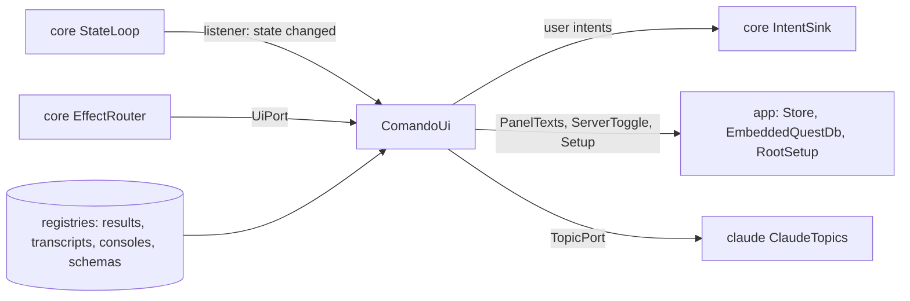

# `ui`

The Swing window: the shell, the editor panels, the lower panel and side pane, the sidebar, the dialogs, the widgets and
the kit they share. It renders `core`'s `AppState`, turns input into intents, and does the effects addressed to the
window. It depends on `core` and the UI libraries (FlatLaf and its extras, jsvg, RSyntaxTextArea and AutoComplete,
CommonMark with its tables extension, java-diff-utils, JediTerm, pty4j, Jackson; slf4j-jdk14 at run time), never on
`db`, `claude`, `mcp` or `tools`. `app` alone constructs it.

1. [Architecture](#1-architecture)
2. [Interface with the rest of the app](#2-interface-with-the-rest-of-the-app)
3. [Threads](#3-threads)
4. [Tests](#4-tests)

## 1. Architecture

The packages under `dev.marregui.comando.ui`, in layer order: a layer uses only the layers above it in this table.

| Package | Holds |
|---|---|
| `kit` | what every layer shares, one subpackage each: `theme` (palette, tints), `icon`, `action` (`Command`, `ActionRegistry`, the palette, menu entries), `async` (`Edt`, `Coalescer`, `EdtWatchdog`, `UiErrands`), `overlay`, `format`, `text` (editors, Markdown and HTML panes, diffs, links, `MermaidDiagrams`, `LocalImages`), `tree`, `tabs`, `layout`, `resource` (resource actions), `desktop` (browser, external editor, file choosers, `DesktopTrash`, platform keys), `vcs` (the Files tab's git marks, opened files) |
| `widget` | the contract: `Widget`, `WidgetContext`, `WidgetRegistry`; `capability` (`Searchable`, `Copyable`, `Exportable`, `Zoomable`, the find bar) |
| `widgets` | one package per widget: `approval`, `changes`, `console`, `diff`, `editor`, `markdown`, `plot`, `table`, `terminal`, `text`, `transcript` (with `doc` and `render`), `tree` |
| `panels` | the window's regions: `Workspace`, `EditorPanel`, `LowerPanel`, `SessionsSidebar` (its rows: `SessionRow`, `ConnectionRow`), `PanelsWithoutSession`, `FilesTab`, `SidePane`, `StatusBar`, `ResultsView`, `TerminalTabs`, `ViewTabs`, `TabCard` |
| `dialogs` | `folders` (the Files tab's folders: `FoldersEditor`, `FoldersDialog`), `jobs` (the kit's scheduled jobs: `JobsEditor`, `JobsDialog`), `resource` (`ResourceDialog`, one dialog for connections and sessions), `sessions` (the import dialog, `StoredConversation`) |
| `shell` | `ComandoUi` (the frame and the UI port), `WindowLayout`, `Menus`, `Keys`, `HelpActions`, `HelpFiles`, `KitActions`, `JobActions`, `LivePlots`, `Notifier`, `OpenFiles`, `DiffWindow`; `ServerToggle` and `Setup`, implemented in `app` |
| (top) | `PanelTexts`: editor text between saves, implemented in `app` |

`UiArchitectureTest` (ArchUnit) fails the build when a widget imports another widget, `panels`, `shell` or `dialogs`;
when `kit` imports `widget`, `widgets`, `panels` or `shell`; and on any reference to `db`, `claude`, `mcp`, `tools` or
`java.sql`. The rest of the order is kept by review.

**Render.** `ComandoUi` registers a `StateLoop.Listener`. Each state change requests a render through a `Coalescer`, so
many changes become at most one pending `invokeLater`, which reads the latest state. Growing stores (transcripts,
consoles) ask for repaints the same way.

**Input.** Every user action is a `Command` in the `ActionRegistry` (menus, keys, palette); a command dispatches an
intent. Blocking work (opening a file, links, exports, the kit's git runs) moves to an errand of `UiErrands`.

**Views.** `WidgetRegistry` maps a placed view's type (`table`, `plot`, `diff`, `markdown`, `text`, `tree`, `console`,
`changes`) to a widget. `ViewTabs` creates it when the view appears, renders it when its version changes, and unmounts
it when it closes.

**Text from outside** (Claude, a database, a file) reaches Swing as text, never as HTML (`Plain`, `MarkdownHtml`).

A new view type is a `ViewSpec` record in `core`, a package under `widgets`, a registration in `ComandoUi`, and for
Claude a case in `mcp`'s `ViewSpecs`.

## 2. Interface with the rest of the app

**Provides.**

| Interface | Methods | Caller |
|---|---|---|
| `UiPort` | `editPanel`, `notifyDesktop`, `forgetPanel`, `deletePanel`, `showFile`, `arrange`, `showFolder`, `showRepos`, `showChange`, `showPlanUsage`; each hands its work to the EDT, an errand (`showFile`) or the store (`forgetPanel`, `deletePanel`) and returns | the reducer's effects, through `EffectRouter` |
| `ComandoUi(Dependencies)`, `topics(port)`, `start()`, `kitStatus(status)`, `close()` | builds and shows the window from any thread; reads the tabs' topics through the port `topics` sets before `start()`; shows the kit's version in the status bar, with its menu (Upgrade the kit…, Back up the brain); closes terminals, live plots, the EDT watchdog and the window, then the errands | `app` |
| `MermaidDiagrams.install(cache)`, `LocalImages.install(cache)` and their `shutdown()` | the drawing services Markdown previews use, with their caches under the data root | `app` |
| `DesktopTrash.moveToTrash(file)` | the desktop's Trash | `app` passes it to `tools` as its `Trash` |

**Needs.** `ComandoUi.Dependencies`, filled by `app`:

| Field | Is |
|---|---|
| `intents`, `state`, `loop` | the `IntentSink`, the state snapshot, the `StateLoop` to listen to |
| `transcripts`, `results`, `consoles`, `schemas` | `core`'s registries, read here |
| `texts` | `PanelTexts`: each panel's file and text (`app`'s `Store`) |
| `catalogue` | the stored conversations for the import dialog, as `StoredConversation` (`app` maps `claude`'s `SessionCatalogue`) |
| `server` | `ServerToggle`: the embedded QuestDB (`app`'s `EmbeddedQuestDb`) |
| `setup` | `Setup`: the kit root comando runs on, the kit's version and newer releases, the brain's backup (`app`'s `RootSetup`); `KitActions` shows the kit in the status bar, sends the upgrade to the session `kit` and offers to restart the sessions on the old kit once it reported; the folders' window has Use the kit's folders; a brain folder's row in the Files tab has Back up the brain; `JobActions` reads the kit's jobs through `Setup` at start, after each change and every minute while the Files tab shows, puts them on the Files tab's Jobs row, and opens the Kit jobs window (record 117) |
| `version`, `home`, `logDir`, `onQuit` | for About, Help and the log; `home` also holds `opened-files`, the files opened once, which the Files tab no longer marks new; what quitting runs once the window has asked |

`PanelTexts`, `ServerToggle` and `Setup` are declared here and implemented in `app`, and `StoredConversation` is a
record declared here that `app` fills, so the window reaches the store, QuestDB, the kit and the stored conversations
without importing them.

**Sends back.** The user's intents: panels, running text, connections, sessions, approvals answered, views, editor
edits, files, Gradle runs, folders, notices ([Architecture §4.2](../docs/architecture.md#42-intents)).

**Resources.**

| Resource | Is |
|---|---|
| `icons/` | SVG icons, and the application's `comando.png` |
| `shell/about.md` | the About card's text |
| `shell/markdown-sheet.md` | the Markdown sheet Help shows |
| `help/tutorial.md` | copied from `docs/tutorial.md` by `ui/build.gradle.kts`, so Help ▸ Tutorial and the docs show one text |

## 3. Threads

| Thread | Kind | Does | Stopped by |
|---|---|---|---|
| EDT | event loop | renders, handles input; owns every Swing component | the JVM's exit |
| `watchdog` | the shared one (`core`'s `Watchdog`) | `EdtWatchdog` probes the EDT every 100 ms; 200 ms is a stall, 1 s (2 s in the JDK's drawing) a hang logged with the EDT's stack | `ComandoUi.close()` closes the EDT's look |
| `mermaid` | strand | `mmdc`, one diagram at a time, 30 s bound | `MermaidDiagrams.shutdown()`, called by `app` |
| `local-images` | strand | the pictures a Markdown view names; SVGs drawn into `cache/images/` | `LocalImages.shutdown()`, called by `app` |
| `open-file`, `show-file`, `log-entry`, `open-link`, `note-link`, `reveal`, `external-editor`, `notify`, `export`, `plot-prepare`, `diff-compute`, `folder-facts`, `read-conversations`, `opened-files`, `kit-status`, `brain-backup`, `write-tutorial`, `show-tutorial`, `pty-preload`, `terminal-exit` | errands of the window (`UiErrands`) | one blocking call each, off the EDT; `notify` runs `osascript`, bounded at 10 s | `ComandoUi.close()`, which interrupts and waits for those still running |

The terminal's threads (JediTerm's emulator and pty4j's process readers) belong to those libraries.

## 4. Tests

Every test class sits in the package of what it tests and uses `testkit`'s fakes where it needs a sink or a state.
Tests that drive components with Swing timers run on the EDT through the `OnEdt` extension.

| Package | Test classes | Covers |
|---|---|---|
| `ui` (top) | 2 | the layer rules (`UiArchitectureTest`), panel titles |
| `kit.*` | 40 | the EDT and its watchdog, commands and keys, overlays, icons, themes, text rendering (`MarkdownHtml`, `HtmlPane`, `SplitDiff`, links), desktop integration, trees, tabs, git marks |
| `widgets.*` | 28 | approvals, changes and the comparison, the command editor and SQL completion, plots, grids, terminals, the painted transcript and its layout |
| `panels` | 19 | the workspace, editor panels and their headers, the sidebar and its rows, the Files tab and its Jobs row, the status bar, the tab card |
| `dialogs.*` | 4 | the folders window, the kit jobs window, the resource dialog, the import dialog |
| `shell` | 19 | menus, keys, window layout, closing, help files, About, the kit's actions and jobs, live plots, notices |

The counts are those at the time of writing; `find ui/src/test/java -name '*Test.java'` lists them.

| Command | Runs |
|---|---|
| `./gradlew :ui:test` | the tests above, headless |
| `./gradlew :ui:transcriptGate` | transcript frame times on `testkit`'s `SyntheticSession` (`TranscriptGate`); fails when p99 exceeds 16 ms |

`TranscriptShot` paints the synthetic session at a scroll offset to a PNG. The real window is tested from `app`
(`./gradlew :app:uiTest`).

Further reading: [UI](../docs/ui.md), [Architecture §8](../docs/architecture.md#8-ui-packages).
