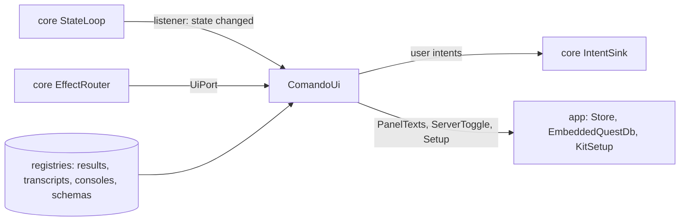

# `ui`

The Swing window: the shell, the editor panels, the lower panel and side pane, the sidebar, the dialogs, the widgets
and the kit they share. It renders `core`'s `AppState`, turns input into intents, and does the effects addressed to
the window. It depends on `core` and the UI libraries (FlatLaf, jsvg, RSyntaxTextArea, CommonMark, java-diff-utils,
JediTerm, pty4j, Jackson), never on `db`, `claude`, `mcp` or `tools`.

1. [Architecture](#1-architecture)
2. [Interface with the rest of the app](#2-interface-with-the-rest-of-the-app)
3. [Threads](#3-threads)
4. [Tests](#4-tests)

## 1. Architecture

```
dev.marregui.comando.ui
├── kit/        theme, icons, commands, overlays, EDT helpers, formatting, text, trees, tabs, desktop, vcs
├── widget/     the contract: Widget, WidgetContext, WidgetRegistry; capability/ (Searchable, Copyable, …)
├── widgets/    one package per widget: approval, changes, console, diff, editor, markdown, plot, table, terminal, text,
│               transcript, tree
├── panels/     the window's regions: Workspace, EditorPanel, LowerPanel, SessionsSidebar, FilesTab, SidePane, …
├── dialogs/    folders/ (the Files tab's folders), resource/ (one dialog for connections and sessions), sessions/ (import)
├── shell/      ComandoUi (the frame and the UI port), Menus, Keys, HelpActions, LivePlots, Notifier, WindowLayout, DiffWindow, …
└── PanelTexts  editor text between saves (implemented in app)
```

A layer uses only the layers above it in this list; a widget imports no other widget. `UiArchitectureTest`
(ArchUnit) fails the build on a breach, and on any reference to `db`, `claude`, `mcp`, `tools` or `java.sql`.

- **Render.** `ComandoUi` registers a `StateLoop.Listener`; each state change requests a render through a
  `Coalescer`, so many changes become at most one pending `invokeLater`, which reads the latest state. Growing stores
  (transcripts, consoles) ask for repaints the same way.
- **Input.** Every user action is a `Command` in the `ActionRegistry` (menus, keys, palette); a command dispatches an
  intent. Blocking work (opening a file, links, exports, the kit) moves to a virtual thread.
- **Views.** `WidgetRegistry` maps a placed view's type (`table`, `plot`, `diff`, `markdown`, `text`, `tree`,
  `console`) to a widget; `ViewTabs` creates it when the view appears, renders it when its version changes, unmounts
  it when it closes.
- **Text from outside** (Claude, a database, a file) reaches Swing as text, never as HTML (`Plain`, `MarkdownHtml`).

A new view type is a `ViewSpec` record in `core`, a package under `widgets/`, a registration in `ComandoUi`, and for
Claude a case in `mcp`'s `ViewSpecs`.

## 2. Interface with the rest of the app



**Provides.**

| Interface | Methods | Caller |
|---|---|---|
| `UiPort` | `editPanel`, `notifyDesktop`, `forgetPanel`, `deletePanel`, `showFile`, `arrange`, `showFolder`, `showRepos`, `showChange`, `showPlanUsage`; each hands its work to the EDT, a virtual thread (`showFile`) or the store (`forgetPanel`, `deletePanel`) and returns | the reducer's effects, through `EffectRouter` |
| `ComandoUi(Dependencies)`, `start()`, `offerKit(offer)`, `close()` | builds and shows the window from any thread; asks about the Claude Code kit; closes terminals, live plots, the EDT watchdog and the window | `app` |
| `MermaidDiagrams.install(cache)`, `LocalImages.install(cache)` and their `shutdown()` | the drawing services Markdown previews use, with their caches under the data root | `app` |
| `DesktopTrash.moveToTrash(file)` | the desktop's Trash | `app` passes it to `tools` as its `Trash` |

**Needs.** `ComandoUi.Dependencies`, filled by `app`:

| Field | Is |
|---|---|
| `intents`, `state`, `loop` | the `IntentSink`, the state snapshot, the `StateLoop` to listen to |
| `transcripts`, `results`, `consoles`, `schemas` | `core`'s registries, read here |
| `texts` | `PanelTexts`: each panel's file and text (`app`'s `Store`) |
| `catalogue` | the stored conversations for the import dialog, as `StoredConversation` (`app` maps `claude`'s `SessionCatalogue`) |
| `server` | `ServerToggle`: the embedded QuestDB (`app`'s `EmbeddedQuestDb`) |
| `setup` | `Setup`: `folders.json` and the Claude Code kit (`app`'s `KitSetup`) |
| `version`, `home`, `logDir`, `onQuit` | for About, Help and the log; what quitting runs once the window has asked |

`PanelTexts`, `ServerToggle`, `Setup` and `StoredConversation` are declared here and implemented in `app`, so the
window reaches the store, QuestDB and the kit without importing them.

**Sends back.** The user's intents: panels, running text, connections, sessions, approvals answered, views, editor
edits, files, Gradle runs, folders, notices ([Architecture §4.2](../docs/architecture.md#42-intents)).

**Resources.** `icons/` (SVG); `shell/about.md` (the About card's words); `shell/markdown-sheet.md`; the tutorial,
copied from `docs/tutorial.md` by `ui/build.gradle.kts` so Help and the docs never disagree.

## 3. Threads

| Thread | Does |
|---|---|
| EDT | renders, handles input; owns every Swing component |
| `edt-watchdog` | probes the EDT every 100 ms; 200 ms is a stall, 1 s (2 s in the JDK's drawing) a hang logged with the EDT's stack |
| `mermaid` | `mmdc`, one diagram at a time, 30 s bound |
| `local-images` | pictures a Markdown view names; SVGs drawn into `cache/images/` |
| `pty-preload`, short virtual threads | one blocking call each off the EDT |

## 4. Tests

- Widget, panel, shell and kit tests in `src/test`, using `testkit`'s fakes.
- `UiArchitectureTest`: the package layers and the ban on adapter modules.
- `./gradlew :ui:transcriptGate`: transcript frame times on `testkit`'s `SyntheticSession`; fails when p99 exceeds
  16 ms.
- The real window is tested from `app` (`:app:uiTest`), which replays intent logs against it.

Further reading: [UI](../docs/ui.md), [Architecture §8](../docs/architecture.md#8-ui-packages).
